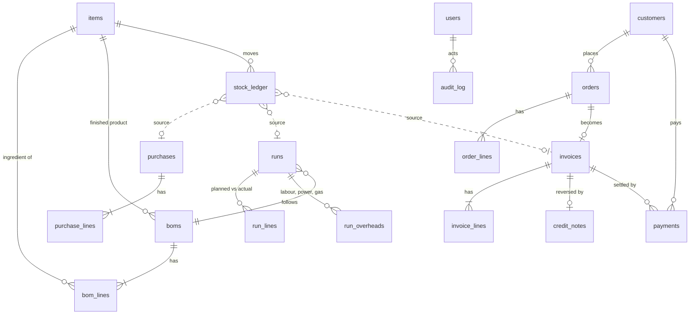

# Design note

## 1. Data model

Raw materials, packaging and finished goods are all rows in `items` (`kind`), so one ledger serves every stock type. `stock_ledger` rows carry `mtype` (OPENING, PURCHASE, PROD_ISSUE, PROD_OUTPUT, SALE, SALE_RETURN, ADJUSTMENT, COST_ADJ, REVERSAL) and `ref_type/ref_id/ref_no`, which point back to the source document.

**Conventions.** Money is integer paise. Quantities are integers in the item's base unit (g, ml, piece, packet), so 40 kg is stored as 40,000 g and nothing drifts. Conversion (kg, g, L, ml, piece, packet, carton of packets) happens only at input and display. Batch counts are decimal text. Tax is computed with `Decimal` and rounded half-up to the paisa.

**Integrity in the database, not just the code.** SQLite triggers make `stock_ledger` and `audit_log` append-only, forbid deleting invoices or invoice lines, and lock invoice amounts. A posted invoice can only be cancelled by a credit note, which also returns dispatched stock through a ledger row.

## 2. How stock and BOM consumption are computed

**Stock balance is never stored.** `balance(item) = SUM(qty_base)` over the ledger (value likewise). Opening + receipts − issues ± adjustments = closing holds by construction, and the stock-summary report is built from the same ledger, so each row reconciles. An issue that would take stock negative is refused, which is also what blocks dispatch when finished goods are short.

**Production loop.**
1. A run copies the active BOM into `run_lines` scaled by the number of batches: `planned = bom_qty × batches`, `expected output = yield × batches`.
2. *Issue* posts PROD_ISSUE ledger rows for each raw material at the current weighted-average cost and records `actual_base` and `actual_value_paise` on the line.
3. *Complete* takes good packets and damaged units. Per-packet items (pouches) default to `good + damaged`; other packaging is entered (cartons). Anything not yet issued is issued now, then finished goods are received at the run's total cost.
4. **Variance** per line is `(actual − planned) / planned`; yield variance is `(good − expected) / expected`. A value is flagged when its absolute size is strictly greater than the tolerance setting (default 3%).

**Sales loop.** Order lines take the customer's price or the list price. The admin screen shows on-hand stock against the order before approval. Approving creates no stock movement; the invoice (numbered `INV/<financial year>/<seq>`) fixes GSTIN, HSN and the tax split: CGST + SGST when the customer's state equals the seller's, otherwise IGST. **Dispatch** posts the stock-out and costs it at weighted average.

## 3. Costing and valuation

**Valuation: moving weighted average.** An issue is valued at `total value ÷ total quantity × issued quantity`. When an issue empties the item, it takes the whole remaining value, so rounding never leaves a residue. It was chosen over FIFO and last price because a snack factory buys flour and oil repeatedly at changing rates and mixes them in the bin, so a blended rate matches how the material is physically used. It is also simple to explain and audit, and acceptable under AS-2. Last price would make the cost swing with each purchase, and FIFO adds batch-layer bookkeeping that adds little here.

**Overhead rule.** Labour, gas and power are entered against the run they belong to. Cost per packet = (materials at weighted average + run overheads) ÷ **good** packets. Dividing by good rather than expected packets deliberately loads yield loss and damaged pouches onto the saleable output, so a wasteful run shows a worse cost. Overheads added after completion post a value-only cost adjustment, so the finished-goods stock value includes them. Margin = selling price − cost per packet.

**Benchmark result:** materials ₹4,055.00 + overheads ₹1,800.00 = ₹5,855.00 ÷ 188 = **₹31.14 per packet**, margin ₹18.86 (37.7%).
